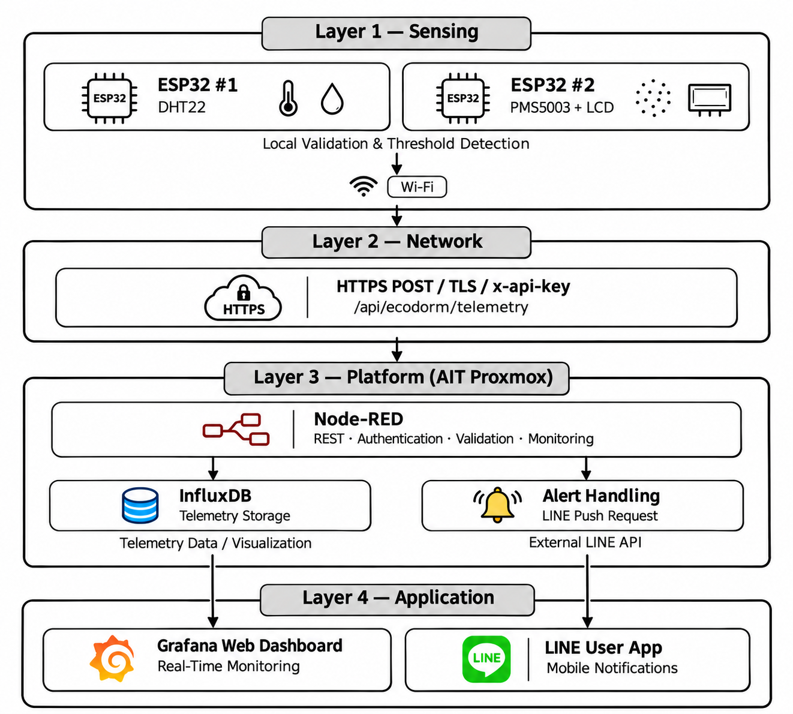

# EcoDorm — Secure Edge–Cloud IoT Dormitory Monitoring

EcoDorm is an AIT AST01.41 capstone prototype for measuring dormitory temperature, humidity, and particulate matter. It combines local sensor validation on two ESP32 devices with authenticated HTTPS telemetry, Node-RED processing, InfluxDB time-series storage, Grafana dashboards, and LINE Messaging alerts.

> This repository contains a **sanitized source-code snapshot**, not live credentials or a ready-to-run hosted instance. Replace placeholders in your **local** configuration before deployment. The original system runs in one Proxmox LXC (CT 123, Test01); no separate Docker containers or MQTT broker were deployed.

## Architecture



| Layer | Implemented components | Responsibility |
|---|---|---|
| 1 — Sensing | ESP32 #1 + DHT22; ESP32 #2 + PMS5003 + 20×4 LCD | Acquisition, local validation and threshold checks |
| 2 — Network | 2.4-GHz Wi-Fi, HTTPS POST / TLS, `x-api-key` | Authenticated telemetry transfer |
| 3 — Platform | AIT Proxmox LXC, Node-RED, InfluxDB | API validation, condition classification, time-series storage, alert preparation |
| 4 — Application | Grafana, LINE Messaging API | Visualization, device status, user notifications |

## Repository layout

```text
firmware/     ESP32_DHT22.ino and ESP32_PMS5003.ino
node-red/     ecodorm_flows_github.json (Node-RED export)
grafana/      ecodorm_dashboard_github.json (Grafana dashboard JSON v2)
benchmarks/   Original sysbench and iPerf3 output files
docs/         Architecture diagram and AI use declaration
README.md     Overview and reproduction guide
.gitignore    Rules to prevent common credential files being committed
```

## Hardware and firmware

- **ESP32 #1:** DHT22 on GPIO 27; reads approximately every **5 s**; sends telemetry every **60 s** when a valid measurement and connection are available.
- **ESP32 #2:** PMS5003 using UART2 RX GPIO 16 at 9600 baud; 20×4 I2C LCD (SDA GPIO 25, SCL GPIO 26, address `0x27`); reads approximately every **2 s**; sends telemetry every **60 s** when valid and connected. The PMS5003 has a startup warm-up period in the firmware.
- **Power:** Both nodes use external **5 V USB power adapters**.
- **Libraries:** Arduino-ESP32 core with built-in `WiFi.h`, `WiFiClientSecure.h`, and `HTTPClient.h`; DHT sensor library (`DHT.h`) for ESP32 #1; Adafruit PM25 AQI (`Adafruit_PM25AQI.h`) and hd44780 (`hd44780.h`) for ESP32 #2. Install library dependencies required by those packages. The firmware uses `useBuiltinCACertBundle()` and NTP time synchronization for HTTPS certificate validation; use a compatible ESP32 core and valid HTTPS certificate.

For each `.ino` file, replace `YOUR_WIFI_SSID`, `YOUR_WIFI_PASSWORD`, `YOUR_ECODORM_API_KEY`, and `YOUR_HOST` **locally** before uploading to the ESP32. Do not commit the configured files containing real credentials.

## Backend and configuration

1. Provision an Ubuntu Linux environment (the prototype used **AIT Proxmox LXC CT 123**). Install and run **Node-RED**, **InfluxDB 2.x**, and **Grafana**. The provided flow depends on the Node-RED package `node-red-contrib-influxdb` (export records version `0.7.0`).
2. Create/configure the InfluxDB organization and bucket. The exported flow uses organization `ait-iot-lab7`, bucket `ecodorm_telemetry`, and measurement `ecodorm_sensors`. Set your own InfluxDB authentication token **in the installed Node-RED/InfluxDB configuration**, not in this repository. The sample flow points to a localhost InfluxDB instance on port 8086.
3. Import [`node-red/ecodorm_flows_github.json`](node-red/ecodorm_flows_github.json) into Node-RED. Configure flow environment values `ECODORM_API_KEY` (strong shared API key, at least 32 characters), `LINE_CHANNEL_ACCESS_TOKEN`, and `LINE_USER_ID` with your own values. The public export contains only variable names and a placeholder for the LINE user ID.
4. Expose the Node-RED endpoint through correctly configured **HTTPS** (e.g., a reverse proxy with a valid certificate). The Node-RED HTTP-in node uses `/api/ecodorm/telemetry` and does not by itself configure TLS. Restrict network access as appropriate.
5. Configure a Grafana **InfluxDB** datasource for the appropriate InfluxDB organization/bucket and credentials. Import [`grafana/ecodorm_dashboard_github.json`](grafana/ecodorm_dashboard_github.json). Rebind the datasource references if Grafana reports missing datasource UIDs; the original export retains IDs from its source dashboard.
6. Upload the locally configured firmware to each ESP32 and check serial logs at **115200 baud**. Verify accepted telemetry and dashboard measurements before testing notifications.

**Security note:** The prototype uses a shared API key and HTTPS/TLS; it does not implement per-device key rotation, JWT authentication, or offline telemetry buffering. LINE tokens, Wi-Fi passwords, InfluxDB tokens, and other secrets must remain outside GitHub.

## REST API contract

```http
POST /api/ecodorm/telemetry
Content-Type: application/json
x-api-key: YOUR_ECODORM_API_KEY
```

DHT22 sample:

```json
{"device_id":"temp01","temperature":28.4,"humidity":65.0}
```

PMS5003 sample:

```json
{"device_id":"air01","pm1":6,"pm25":10,"pm10":11,"status":"NORMAL"}
```

The system returns **202 Accepted** for authorized, valid telemetry; **400** for invalid payloads; **401** for missing/incorrect keys; and **503** if server authentication is not configured. A 202 response acknowledges ingestion for processing, not confirmed database persistence.

## Local validation and alerts

The ESP32 firmwares check basic sensor validity. The platform also validates incoming sensor ranges, computes environmental severity, and prepares notification events. Prototype warning/critical thresholds are **not regulatory health limits**:

| Metric | Warning | Critical |
|---|---|---|
| Temperature | >32 °C | >36 °C |
| Humidity | >75% | >85% |
| PM2.5 | >35 µg/m³ | ≥76 µg/m³ |

Device-health monitoring marks a device **offline** after approximately **180 s** without valid received telemetry (with 30-second monitoring checks on the backend). LINE Messaging is used for status-change and offline/online notifications.

## Experimental benchmarks

Raw outputs are in [`benchmarks/`](benchmarks/). The values below describe the **Proxmox test environment**, not a measured cloud-only vs edge–cloud speedup.

| Experiment | Measured result |
|---|---|
| sysbench CPU, 1 thread, 30 s, prime limit 20000 | 393.31 events/s |
| sysbench CPU, 4 threads, 30 s, prime limit 20000 | 1,479.66 events/s |
| iPerf3 TCP, WSL2 → Proxmox, 10 s | 39.9 Mbps receiver |
| iPerf3 TCP, Proxmox → WSL2, 10 s | 84.8 Mbps receiver |

These are individual benchmark runs. Cloud-only baseline measurements, telemetry-level bandwidth savings, power efficiency, and end-to-end HTTP latency were **not measured** in this snapshot.

## Limitations and academic disclosure

The prototype is intended for monitoring and alerts, with no actuator control. The repo does not contain credentials, live InfluxDB data, or a deployed MQTT broker. See [`docs/AI declaration.txt`](docs/AI%20declaration.txt) for the author's AI-use statement. The architecture figure should be included only if it was drawn by the author as declared.
